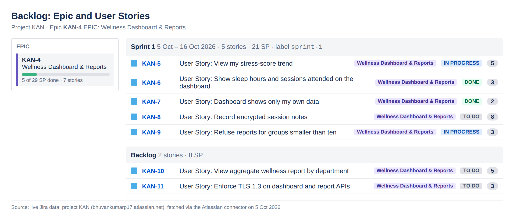
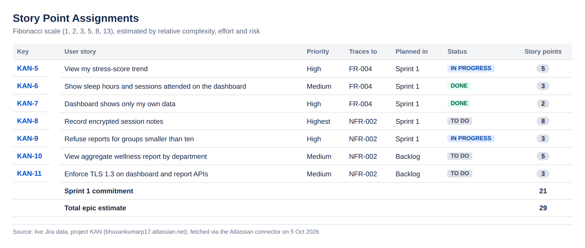
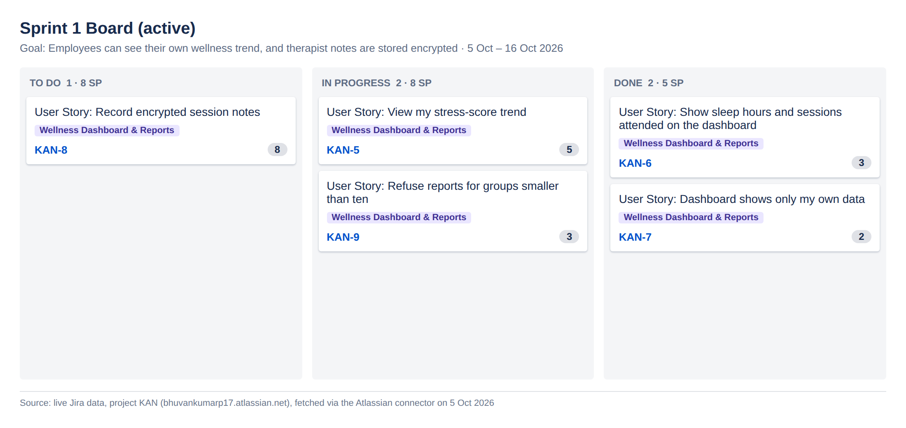
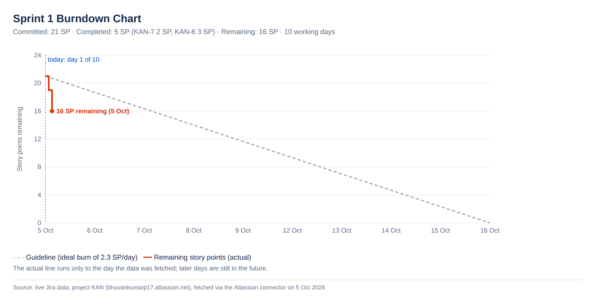

# Lab 2: Agile Planning in Jira

**Student:** BHUVAN KUMAR P (PES1UG24AM069)  
**Problem Statement #14:** Corporate Mental Wellness & Counseling Platform
**My unique Epic:** KAN-4 *Wellness Dashboard & Reports*

## Objective

Plan my individual Epic in Jira: break it into user stories, estimate them in story points, plan and run a sprint, read the burndown chart, and answer the reflection questions.

## The Epic

KAN-4 gives each audience only the wellness data it is entitled to:
- **Employees:** a trend of their own indicators across their last six assessments (FR-004, UC-04).
- **Therapists:** session notes encrypted at rest with AES-256 (NFR-002, UC-06).
- **Wellness Program Administrators:** aggregate reports only, refused for groups smaller than ten (NFR-002, UC-07).

| Key | User story | Story points | Planned in |
|---|---|---|---|
| KAN-5 | View my stress-score trend | 5 | Sprint 1 |
| KAN-6 | Show sleep hours and sessions attended on the dashboard | 3 | Sprint 1 |
| KAN-7 | Dashboard shows only my own data | 2 | Sprint 1 |
| KAN-8 | Record encrypted session notes | 8 | Sprint 1 |
| KAN-9 | Refuse reports for groups smaller than ten | 3 | Sprint 1 |
| KAN-10 | View aggregate wellness report by department | 5 | Backlog |
| KAN-11 | Enforce TLS 1.3 on dashboard and report APIs | 3 | Backlog |
| | **Sprint 1 commitment / Epic total** | **21 / 29** | |

- **Sprint 1:** 5–16 Oct 2026, 10 working days.
- **On day 1:** KAN-6 and KAN-7 were Done (5 points), leaving 16 points, below the ideal guideline that burns 21 points to zero over the sprint.

## Files

| File | Description |
|---|---|
| [Lab2_Individual_Report_PES1UG24AM069.docx](Lab2_Individual_Report_PES1UG24AM069.docx) | Individual report: Epic, backlog, story points, sprint board, burndown, reflection answers |
| [screenshots/01_backlog_epics_stories.png](screenshots/01_backlog_epics_stories.png) | Backlog with the Epic and user stories |
| [screenshots/02_story_points.png](screenshots/02_story_points.png) | Story point assignments |
| [screenshots/03_sprint_board.png](screenshots/03_sprint_board.png) | Sprint 1 board (active sprint view) |
| [screenshots/04_burndown_chart.png](screenshots/04_burndown_chart.png) | Sprint 1 burndown chart |

> **Note on the images:** the Jira project (KAN) was created from the Kanban template, which had no Sprints, Story type or Story Points field enabled. So:
> - stories are Jira Tasks titled "User Story: …" with a `user-story` label;
> - story points and the sprint are recorded in labels (`sp-N`, `sprint-1`);
> - the four images were **rendered from the live Jira data** pulled through the Atlassian connector, not captured from Jira's own UI. Each image states its source at the bottom.

## Tools

Jira Software (project KAN), Atlassian connector in Claude Code, Microsoft Word.
