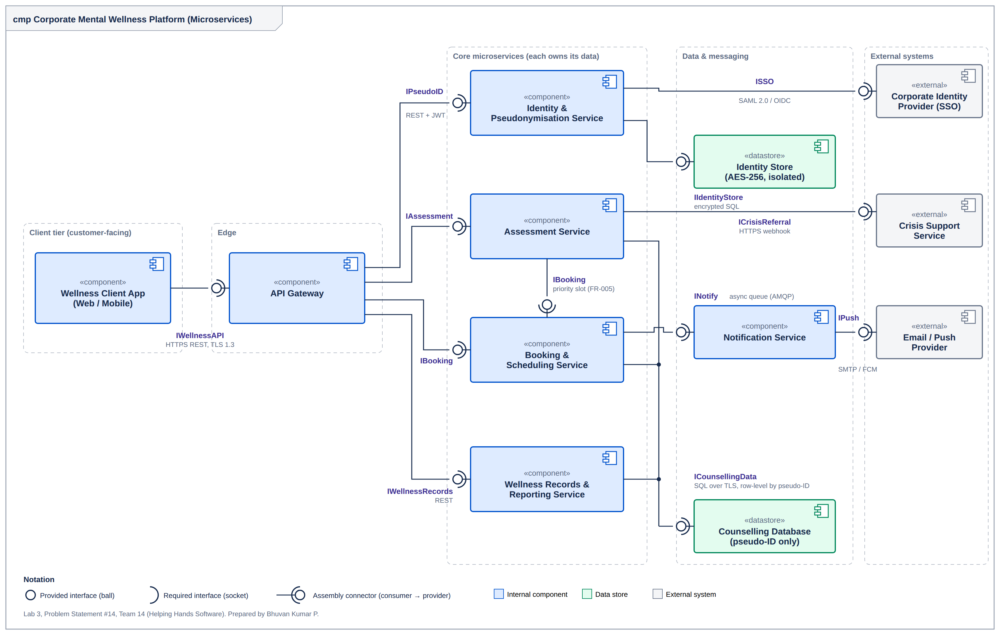

# Lab 3: Component Modelling & Architectural Pattern Selection

**Student:** BHUVAN KUMAR P (PES1UG24AM069)  
**Problem Statement #14:** Corporate Mental Wellness & Counseling Platform

## Objective

Compare architectural styles (Layered, Microservices, Client-Server), choose the most suitable one for the scenario, model it as a UML component diagram with provided and required interfaces, and justify the choice in a one-page write-up.

## Decision

> We chose **Microservices Architecture** for the Corporate Mental Wellness & Counseling Platform.

- **Reason 1:** the pseudo-ID mapping lives in its own isolated Identity service and Identity Store (FR-001, NFR-002), so a leak of counselling data identifies nobody.
- **Reason 2:** booking peaks (NFR-001: 500 concurrent users, slot list under 2 s) can be scaled independently, and crisis escalation stays available if another service fails.
- **Security:** the API Gateway enforces TLS 1.3 and validates a pseudo-ID token; each service has its own credentials and AES-256 keys; reports are released only for groups of ten or more.
- **Performance:** only the Booking service is scaled at peak, and confirmations go through an async queue so they never delay a booking.

## Component diagram

- **Components:** Wellness Client App, API Gateway, Identity & Pseudonymisation Service, Assessment Service, Booking & Scheduling Service, Wellness Records & Reporting Service, Notification Service.
- **Data stores:** Identity Store, Counselling Database.
- **External systems:** Corporate Identity Provider (SSO), Crisis Support Service, Email/Push Provider.
- **Interfaces (ball-and-socket):** IWellnessAPI, IPseudoID, IAssessment, IBooking, IWellnessRecords, INotify, IIdentityStore, ICounsellingData, ISSO, ICrisisReferral, IPush. Each is labelled with its protocol.

## Files

| File | Description |
|---|---|
| [Component_Diagram_Lab3_PES1UG24AM069.png](Component_Diagram_Lab3_PES1UG24AM069.png) | UML component diagram (PNG) |
| [Component_Diagram_Lab3_PES1UG24AM069.pdf](Component_Diagram_Lab3_PES1UG24AM069.pdf) | UML component diagram (PDF) |
| [Component_Diagram_Lab3_PES1UG24AM069.svg](Component_Diagram_Lab3_PES1UG24AM069.svg) | Diagram source (SVG) |
| [Architecture_Justification_Lab3_PES1UG24AM069.docx](Architecture_Justification_Lab3_PES1UG24AM069.docx) | One-page written justification (Word) |
| [Architecture_Justification_Lab3_PES1UG24AM069.pdf](Architecture_Justification_Lab3_PES1UG24AM069.pdf) | Same justification (PDF) |

## Tools

UML component diagram notation (drawn as SVG and exported to PNG/PDF), Microsoft Word.
